<p align="center">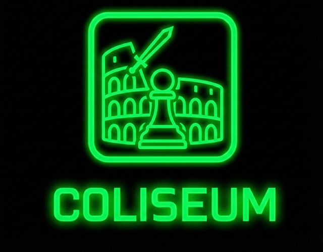</p>

# Coliseum

Coliseum is a chess engine GUI for Windows and Linux, built to host, manage, test and watch chess engine tournaments. It is designed to be much simpler and easier to use than legacy tools like Arena Chess GUI.

If you want to test engines, run automated tournaments, measure how strong an engine really is, or analyze games without dealing with clunky layouts and outdated configuration menus, Coliseum is a modern alternative.

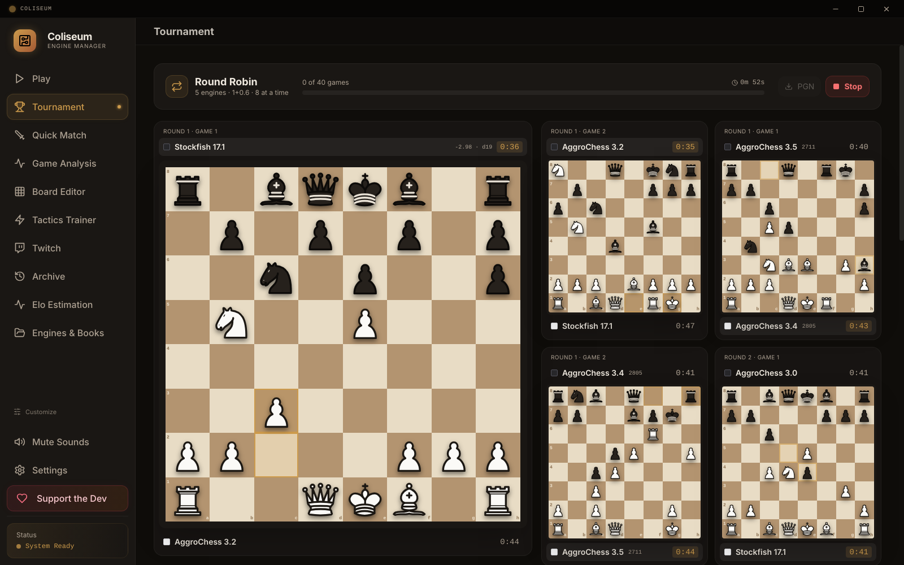

## Features

### Engine Tournaments
Run automated tournaments between any number of UCI or WinBoard chess engines. Every tournament is played in **matches**: two games from the same opening, one with each engine as White, so neither engine gets the luckier colour or opening.

- **Gauntlet**: one main engine plays every opponent as many matches as you choose. For example, 2 opponents x 1 match = 2 matches = 4 games. Ideal for testing a new version of your engine against a field.
- **Round Robin**: everyone plays everyone, with a full standings table and cross table.
- **Swiss**: a set number of rounds, pairing engines on similar scores without rematches. Ties are split by Buchholz, then Sonneborn-Berger.
- **Knockout** and **Double Knockout**: a level match goes to two more 2-game tiebreaks, then sudden-death games, so a draw never decides who goes through.
- **SPRT Test**: is a new build of your engine stronger? Two engines play game pairs until a sequential probability ratio test accepts H0 or H1, the way Fishtest and OpenBench test engines (see below).

Games can use a clock (bullet, blitz, rapid or your own), a fixed time per move, a fixed search depth or a fixed number of nodes. Start them from a built-in set of 50 balanced openings, an EPD or PGN opening suite (such as the 8-move or UHO suites, in order or shuffled), your own Polyglot opening book, or the normal starting position. Adjudication ends games that are already decided: a resign rule when both engines agree a side is lost, a draw rule when both scores stay near zero, and an optional move limit. Several games can run at once (Coliseum suggests a safe number for your CPU). Unfinished tournaments can be resumed later, and the whole event exports as one PGN with full headers.

### SPRT Testing
Set the hypotheses (Elo0 and Elo1, with presets like gain [0, 5] and no regression [-5, 0]) and the error rates alpha and beta. Coliseum counts game pairs as a pentanomial and shows the log-likelihood ratio between its bounds, the Elo difference with a 95% range, the likelihood of superiority and W/D/L as the test runs. It stops as soon as one hypothesis is accepted, or at a game limit you set.

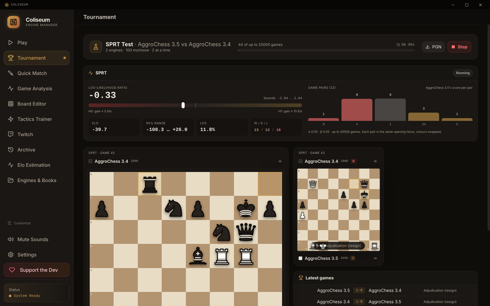

### Results You Can Read
Gauntlets show the main engine's score, its Elo difference against each opponent with an error margin, and a performance rating. Round robins and Swiss events get standings with tiebreaks, and knockouts get a live bracket.

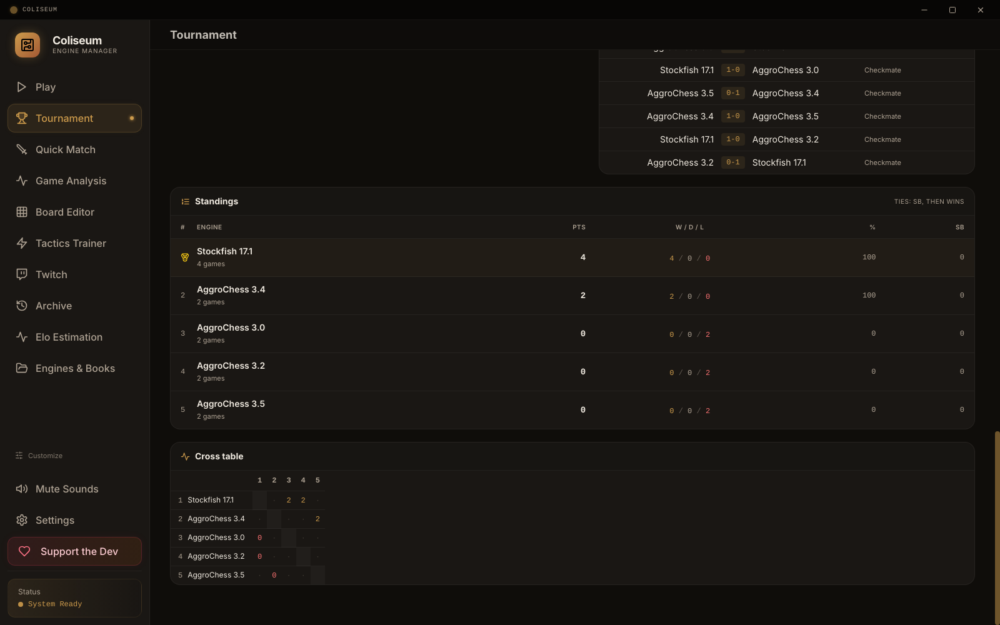

### Elo Estimation
Pick some engines and let them play each other non-stop. Their ratings are worked out from every game they have played, with a ± range that narrows as more games come in, a chart of how the ratings moved, and an optional anchor (fix one engine you know the strength of, and the rest are measured against it).

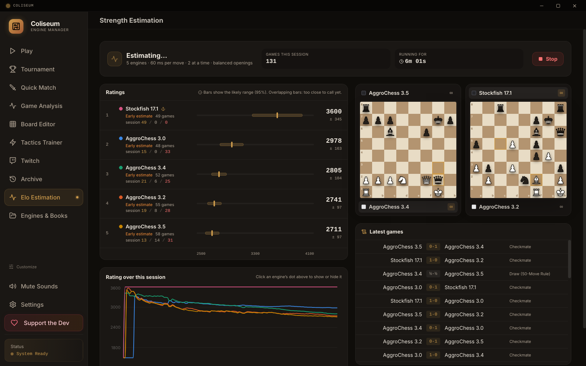

### Live Games
Watch engine games live with each engine's name, rating, clock and evaluation. When several games run at once you can see them all, and click any one to follow it on the big board. The layout adjusts to your window size.

### Play
Play against AggroChess, an aggressive engine in the spirit of Mikhail Tal that comes with Coliseum, in two clicks: pick a colour and a time control, or start from any position by pasting a FEN. You can switch to any other installed engine, and review the game when it's over.

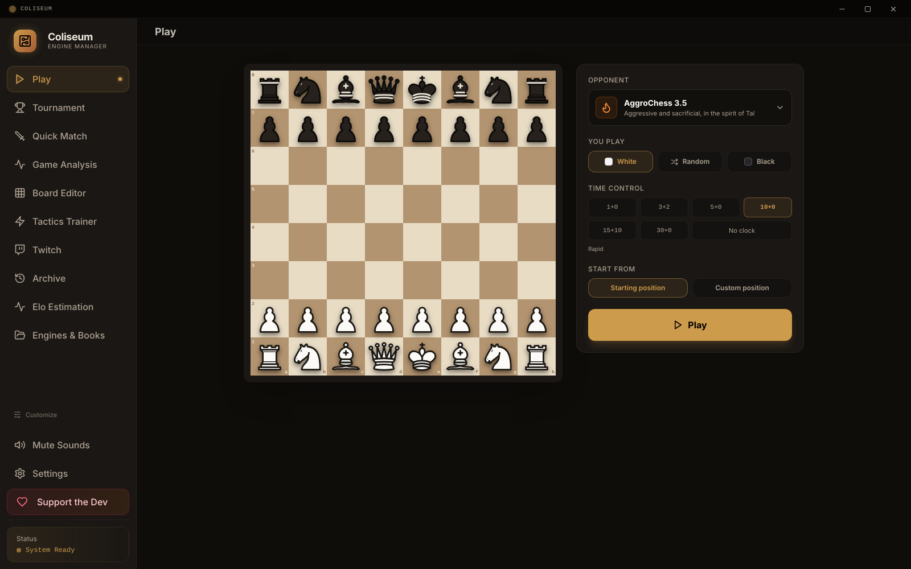

### Quick Match
Play a single game between two engines, or between you and an engine with full control over each side's time and opening book. Finished games are saved to the Archive, where you can search them and export PGNs.

### Opening Books
The **Engines & Books** page has a tab for your Polyglot (.bin) opening books. Each one shows its size, its number of positions and its favourite first moves. You can add books with a button or by dropping them on the window, delete the ones you don't need, and explore any book move by move on a board.

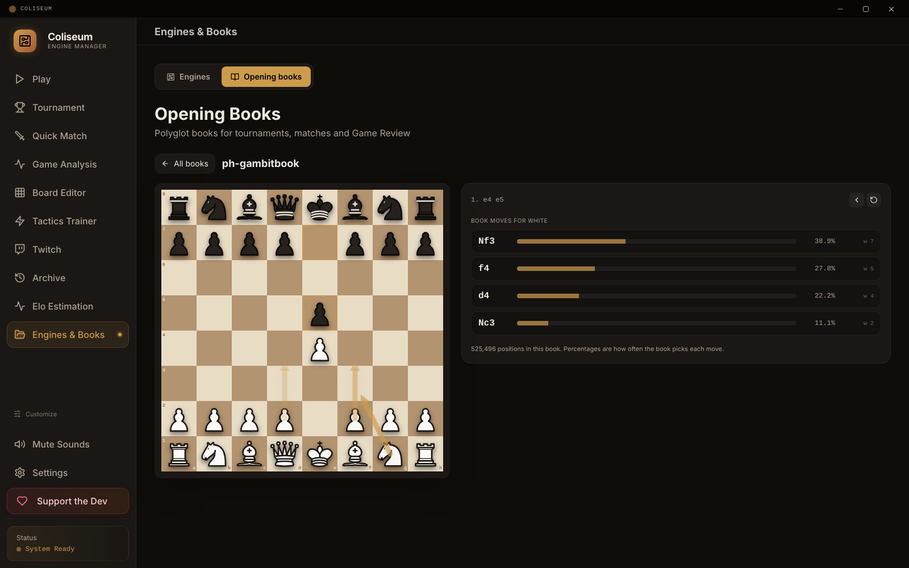

### Engine Management (UCI and WinBoard)
Coliseum works out by itself whether an engine speaks UCI or WinBoard (xboard), and you can also set it by hand. WinBoard engines play in tournaments, SPRT tests, Elo estimation and games; analysis, Game Review and the Tactics Trainer use UCI engines. Import any engine by dropping it into the app, or link it by path so Coliseum uses it from its own folder (handy for engine developers: rebuild any time, and Coliseum runs the newest build). Tweak its options and save custom configurations. Coliseum keeps a career record for every engine: wins, draws, losses, results as White and Black, and its rating over time.

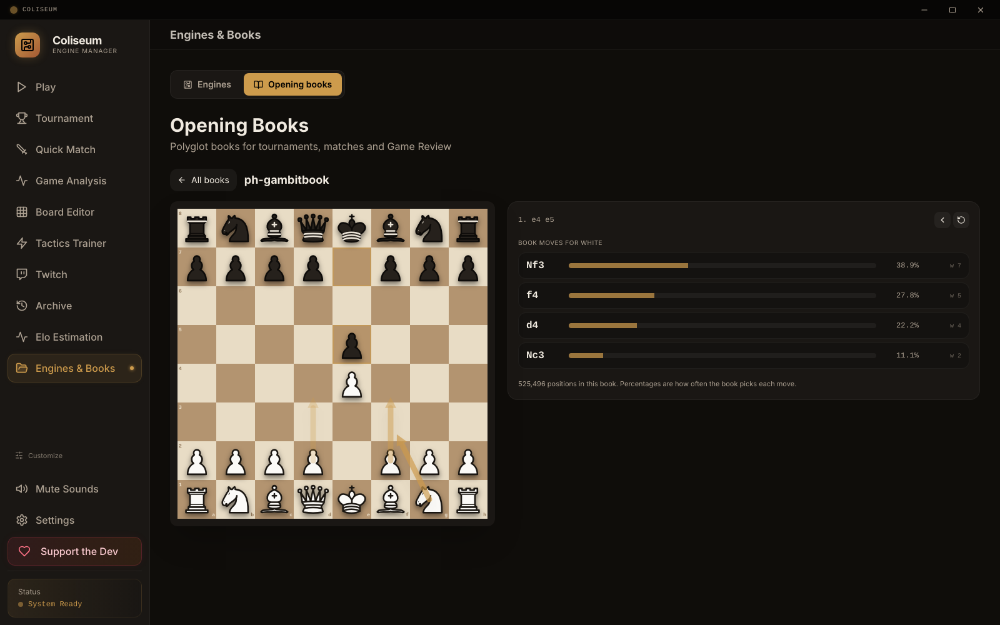

### Game Review & Analysis
Review any game with an engine: accuracy scores, an evaluation graph you can click to jump through the game, key moments, a classification for every move (Brilliant, Great, Best, Excellent, Good, Book, Inaccuracy, Mistake, Miss, Blunder), and an estimated Elo for each player based on how accurately they played. Weak moves show the engine's best alternative on the board, and live analysis shows the top three engine lines.

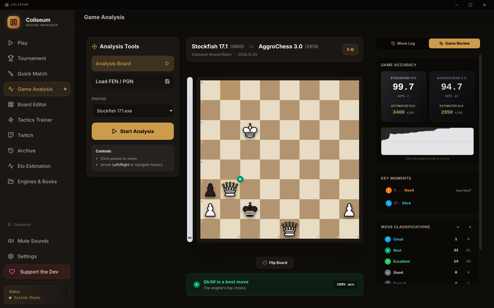

### Board Editor
Set up any position, choose the side to move and castling rights, and send it straight to analysis.

### Tactics Trainer
Turn games into puzzles: forced checkmates, blunder refutations and missed tactics. Pick any engine tournament you've played in Coliseum (they're kept automatically), type your Chess.com or Lichess username to use your own last 25, 50 or 100 games (puzzles come from your moves only), or load any PGN file. Every puzzle is checked by the engine so the solution really works, and the trainer tracks your solved puzzles, success rate and streaks.

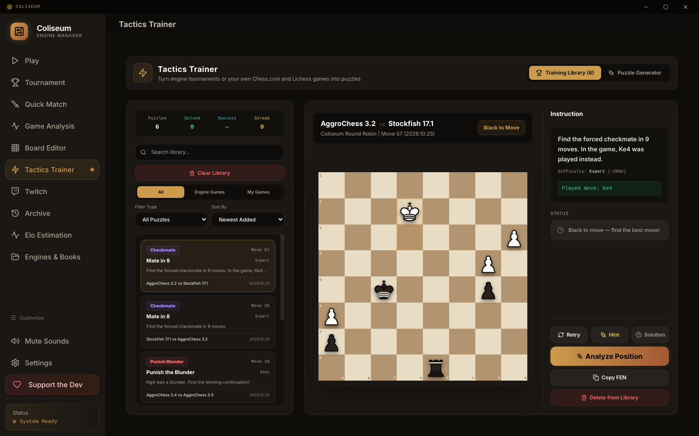

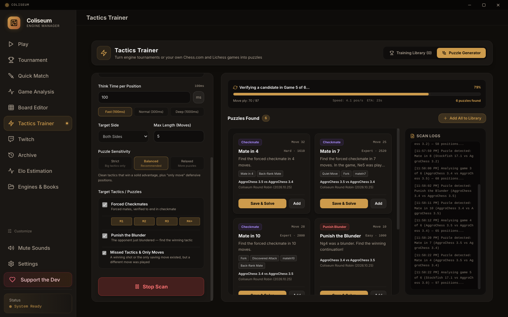

### Twitch Watch Party
Connect your Twitch channel and run a non-stop "Winner Stays On" engine tournament for your stream.

### Make It Yours
Pick a theme in Settings: **Coliseum** (travertine stone and bronze, the default) or **Matrix** (the original neon green). Choose a board and a piece set too; the default board and pieces are told apart by light and dark rather than red and green, so they are easy to read with colour blindness. Click **Customize** under the sidebar tabs to drag them into your own order and hide the ones you don't use.

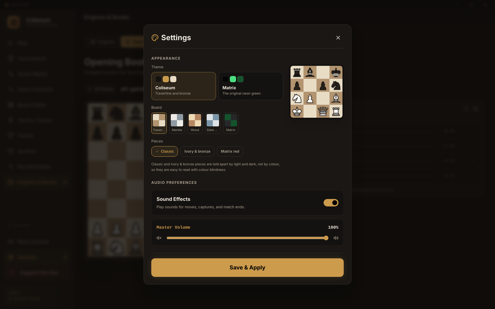

### Audio Feedback
Simple sound effects for moves, captures, check, and game end.

## Installation

Download the latest version from the [Releases](https://github.com/PhelRin/Coliseum/releases) page.

**Windows**
1. Download the setup.exe file.
2. Run the setup.exe.
3. Coliseum should open automatically. If not, you'll find the shortcut on your desktop.

You may also find the Coliseum folder in your AppData.

**Linux** (64-bit)
- **AppImage:** download `Coliseum-<version>-x86_64.AppImage`, make it executable (`chmod +x Coliseum-*.AppImage`) and run it.
- **Debian / Ubuntu:** install `coliseum_<version>_amd64.deb` with `sudo apt install ./coliseum_*_amd64.deb`.

AggroChess and Stockfish come with Coliseum on both systems. On Linux, the engines and books you add are kept in `~/.config/coliseum`. Linux engines are regular executable programs (no `.exe`).

Coliseum checks for updates by itself. When a new version is out it downloads in the background, and you can install it with one click when it's ready.

## Building from source

You need [Node.js](https://nodejs.org/) 18 or newer.

```bash
npm install
npm run electron:dev     # run the app in development mode
npm run electron:build   # build the installer for the system you're on into release/
npm run electron:build:linux   # build the Linux AppImage and .deb
```

Engines and opening books are not part of this repository. Add your own engines from inside the app; to bundle some with the installer, put them in an `Engines` folder (Windows) or `Engines-linux` folder (Linux), and Polyglot books in a `books` folder, before building.

## License

MIT, see [LICENSE](LICENSE).
